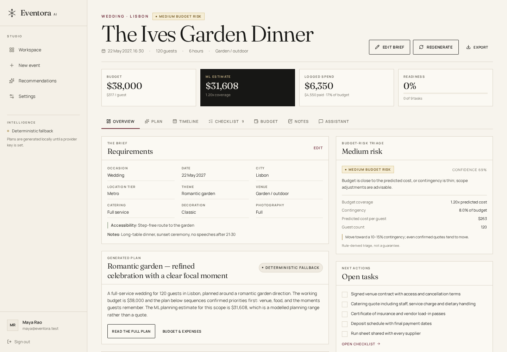
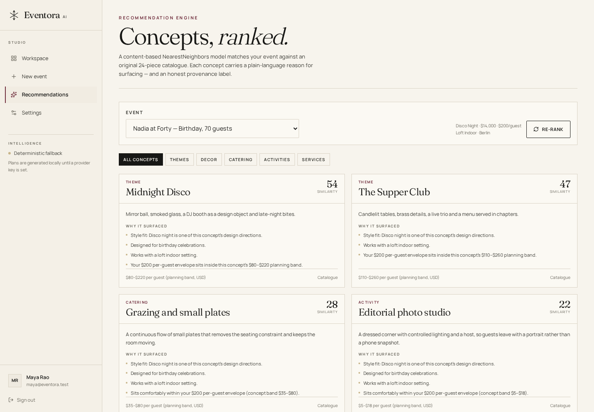

# Eventora AI

**Your imagination. Intelligently orchestrated.**

Eventora AI is a full-stack celebration planning studio for weddings, birthdays, festivals, corporate events, and community gatherings. It combines an editorial frontend, a FastAPI backend, three trained scikit-learn models, a schema-validated generative planning assistant with a deterministic fallback, and a private per-user event workspace.


---

## What is actually working

Verified in this workspace (October 2026):

| Area | Status | Evidence |
|---|---|---|
| Landing page, auth pages, responsive navigation | Working | Screenshots + Playwright run: zero console/page errors, no horizontal overflow at 1440 px or 390 px |
| Sign-up, sign-in, sign-out, session cookies, CSRF | Working | Backend tests; HttpOnly cookie assertions |
| Password reset request/confirm, session invalidation | Working locally; token echo is development-only | Tests |
| Protected event CRUD + per-user isolation | Working | 54-test suite, including cross-account read/update/delete attempts returning 404 |
| Random Forest cost inference | Working | Run `scripts/train_models.py`; MAE **$4,175.38**, RMSE **$5,696.98**, R² **0.9556** on a synthetic holdout split |
| KNN recommendation engine | Working | 24-entry catalogue, cosine similarity, ranked output with reasons |
| Decision-tree budget risk | Working | Accuracy **0.9475**, macro F1 **0.9359** on rule-labelled simulated plans |
| Structured AI plan generation | Working when a provider key is configured; deterministic fallback always works | Fake-provider tests cover valid JSON, invalid JSON, schema violations, timeouts, and prompt injection |
| Dashboard, charts, tasks, expenses, notes, export | Working | Loaded from real API data in the browser |
| Frontend production build | Passing | `npm run build` (Next.js 16.4.2) |
| Backend test suite | Passing | **54 collected; suite exits 0** (`pytest`, Python 3.12) |
| Dependency advisories | Clean at build time | `npm audit --omit=dev` → 0 vulnerabilities; `pip-audit -r backend/requirements.txt --no-deps --disable-pip` → no known vulnerabilities (2026-10-22) |
| GitHub repository under 10 MB | **5.7 MiB (6.0 MB) across 129 tracked files**; model binaries, dependencies, and databases are excluded | See [Repository size](#repository-size) |

**Not claimed:** real vendor prices, vendor availability, bookings, market-accurate cost predictions, penetration testing, or production security certification. No third-party service is connected in this workspace.

---

## Screenshots

| Dashboard | Event workspace |
|---|---|
|  |  |

| Recommendations | Live ML estimator |
|---|---|
|  |  |

Mobile landing: [docs/screenshots/mobile-landing.png](docs/screenshots/mobile-landing.png) · Plan view: [docs/screenshots/workspace-plan.png](docs/screenshots/workspace-plan.png) · Settings: [docs/screenshots/settings.png](docs/screenshots/settings.png) · Wizard: [docs/screenshots/wizard.png](docs/screenshots/wizard.png)

Full-page captures: [landing](docs/screenshots/landing-full.jpg) · [dashboard](docs/screenshots/dashboard-full.jpg) · [event plan](docs/screenshots/workspace-plan-full.jpg) · [recommendations](docs/screenshots/recommendations-full.jpg) · [settings](docs/screenshots/settings-full.jpg)

A demo-video placeholder and recording checklist are in [docs/demo-video.md](docs/demo-video.md). Screenshots use a synthetic demo account (`maya@eventora.test`) with invented event data.

---

## Architecture

```
Browser
  │  same-origin fetch, HttpOnly session cookie + CSRF double-submit
  ▼
Next.js 16 (App Router, React 19, Tailwind v4)
  ├── Server Components: protected pages, initial data
  └── /api/backend/* route handler: forwards cookies to FastAPI
        │
        ▼
FastAPI (Python 3.12, Pydantic 2, SQLAlchemy 2)
  ├── Auth: Argon2id + opaque hashed sessions
  ├── Events/tasks/expenses/notes: ownership-scoped ORM queries
  ├── ML: RandomForestRegressor · NearestNeighbors · DecisionTreeClassifier
  ├── AI: OpenAI-compatible provider + deterministic fallback
  └── SQLite locally / PostgreSQL in production
```

The browser never receives the backend URL, database credentials, or the model-provider key. `BACKEND_INTERNAL_URL` is server-only; all client requests go through the same-origin proxy.

More detail: [docs/architecture.md](docs/architecture.md).

---

## Quick start (from a clean checkout)

Requirements: **Node.js 20+**, **Python 3.12+**, and a POSIX shell.

```bash
# 1. Environment
cp .env.example .env
python -c "import secrets; print(secrets.token_urlsafe(48))"   # put this in APP_SECRET

# 2. Backend
python -m venv .venv
.venv/bin/pip install -r backend/requirements.txt
.venv/bin/python backend/scripts/train_models.py                # writes backend/ml_artifacts/
cd backend && PYTHONPATH=. ../.venv/bin/uvicorn app.main:app --reload --port 8000
# in a second terminal, from the repository root:
.venv/bin/python -m pytest backend/tests                        # 54 collected tests

# 3. Frontend
cd frontend
npm ci
BACKEND_INTERNAL_URL=http://127.0.0.1:8000 npm run dev          # http://localhost:3000
```

Create an account in the UI, then create an event. Plan generation works immediately with the labelled deterministic fallback. To use a real LLM, set these **server-side** variables in `.env` and restart the backend:

```dotenv
AI_PROVIDER=openai
AI_API_KEY=<your server-side key>
AI_BASE_URL=https://api.openai.com/v1
AI_MODEL=gpt-4o-mini
```

OpenAPI docs are available at `http://127.0.0.1:8000/docs` outside production. Do **not** commit `.env` or any key.

### Training artifacts

`backend/ml_artifacts/` is intentionally gitignored. Training is deterministic (seed 42) and takes a few seconds; the Random Forest artifact is roughly 9 MB. If artifacts are absent the API returns a clear `503` for inference and reports `trained: false` in `/api/ml/metrics` rather than inventing predictions.

### Migrations

```bash
cd backend
DATABASE_URL=sqlite:///./eventora.db PYTHONPATH=. ../.venv/bin/alembic upgrade head
```

`AUTO_CREATE_TABLES=true` is for local/test only. Use Alembic in hosted environments.

---

## Machine learning (measured, synthetic)

The training dataset is **synthetic by necessity and documented**: no suitably licensed transaction dataset with these features was available. The target is generated from nine raw features using explicit venue, catering, decor, photography, location, duration, and event-type assumptions plus lognormal noise. Metrics measure recovery of those assumptions, **not real-world forecasting accuracy**. Full methodology and caveats: [docs/ml-methodology.md](docs/ml-methodology.md).

| Model | Algorithm | Split | Result |
|---|---|---|---|
| Cost prediction | `RandomForestRegressor` (300 trees) + `OneHotEncoder` | 2,560 train / 640 test | MAE $4,175.38 · RMSE $5,696.98 · R² 0.9556 · MAE 9.25% of mean |
| Recommendation | `NearestNeighbors` (cosine) over 24 catalogue concepts | Catalogue-based | Style, occasion, venue, budget/guest, capacity vectors; ranked similarity + reasons |
| Budget risk | `DecisionTreeClassifier` (depth 5) | 3,200 / 800 | Accuracy 0.9475 · macro F1 0.9359 |

Checked-in metric snapshots: [docs/metrics/](docs/metrics/). Risk labels come from documented planning rules (coverage ratio, contingency, guest scale); the tree learns those rules from simulated plans. A “low” classification is not a guarantee.

---

## API surface

| Method | Path | Auth | Notes |
|---|---|---|---|
| GET | `/health` | – | DB status, AI configured flag, model readiness; no secrets |
| GET | `/api/config/status` | – | Non-sensitive configuration status |
| POST | `/api/auth/signup` | – | 201 + session cookies; Argon2id |
| POST | `/api/auth/signin` | – | Generic invalid-credentials message |
| GET | `/api/auth/me` | Cookie | Current user |
| POST | `/api/auth/signout` | Cookie + CSRF | Revokes current session |
| POST | `/api/auth/password-reset/request` | – | Always 202; dev-only token echo |
| POST | `/api/auth/password-reset/confirm` | – | Invalidates all sessions |
| PATCH | `/api/auth/profile` | Cookie + CSRF | Display name only |
| DELETE | `/api/auth/account` | Cookie + CSRF + password | Cascades all records |
| POST/GET | `/api/events` | Cookie | Create / paginated list (search, filter) |
| GET/PUT/DELETE | `/api/events/{id}` | Cookie (owner) | 404 for other owners; PUT refreshes ML estimate |
| GET | `/api/events/{id}/export` | Cookie (owner) | JSON attachment |
| POST/GET | `/api/events/{id}/tasks` | Cookie (owner) | Checklist |
| PATCH/DELETE | `/api/events/{id}/tasks/{task_id}` | Cookie (owner) | |
| POST/GET | `/api/events/{id}/expenses` | Cookie (owner) | Amounts in USD cents |
| PATCH/DELETE | `/api/events/{id}/expenses/{expense_id}` | Cookie (owner) | |
| POST/GET/DELETE | `/api/events/{id}/notes` | Cookie (owner) | Plain text only |
| GET | `/api/events/{id}/plan` | Cookie (owner) | Latest validated plan or `null` |
| GET | `/api/dashboard` | Cookie | Aggregates scoped to the user |
| GET | `/api/account/export` | Cookie | Account + events |
| DELETE | `/api/account/data` | Cookie + CSRF | Deletes events and children |
| POST | `/api/ml/predict-cost` | Optional | Public demo, IP rate-limited |
| POST | `/api/ml/recommend` | Optional | IP/user rate-limited |
| POST | `/api/ml/budget-risk` | Optional | IP/user rate-limited |
| GET | `/api/ml/metrics` | – | Metrics + trained flags |
| POST | `/api/ai/generate-plan` | Cookie + CSRF | Schema-validated; persists; seeds tasks once |
| POST | `/api/ai/chat` | Cookie + CSRF | Stateless, grounded excerpt, no persisted transcript |
| GET | `/api/ai/status` | Cookie | Configuration status, never the key |

Mutations require an allowed `Origin` header **and** a CSRF token matching the session. Errors use `{ "error": { "code", "message", "request_id" } }`; validation adds field messages without exposing internals.

---

## Security summary

Implemented: server-only secrets, Argon2id password hashing, opaque hashed session tokens, HttpOnly/SameSite cookies, CSRF double-submit, Origin allowlist, ownership checks on every record, strict Pydantic schemas with length/range bounds and `extra="forbid"`, parameterised ORM queries, body-size limits, database-backed rate limits, AI token/time limits, untrusted-content prompting, output validation, safe error handlers, security headers, `robots.txt` exclusions, `no-store` private API responses, account/event deletion and export.

Documented residual risks and the production checklist are in [docs/security.md](docs/security.md). The app does **not** claim to be “fully secure”; no penetration test was performed.

---

## Testing

```bash
# Backend: 54 collected tests
cd backend && PYTHONPATH=. ../.venv/bin/python -m pytest

# Frontend: typecheck + production build
cd frontend && npm run typecheck && npm run build
```

The suite covers valid/invalid event creation, CRUD, pagination, cross-account isolation on events/tasks/expenses/notes/plans/AI, CSRF and Origin rejection, oversized bodies, SQL-injection and XSS payload handling, rate limiting, CORS, security headers, password reset, account deletion, database-failure error masking, missing ML artifacts, real ML inference/metrics, AI fallback/timeout/invalid-JSON/schema-violation, prompt-injection neutralisation, and a frontend secret scan.

Clean-checkout verification (2026-10-21): the tracked files were exported to an empty directory, `pip install -r backend/requirements.txt` and `npm ci` were run from scratch, models were retrained (seed 42), then `pytest` completed and `npm run build` completed. Re-verified on 2026-10-22: **54 tests collected**, the backend suite exited 0, `tsc --noEmit` was clean, the production build succeeded, and both dependency audits were clean. GitHub Actions repeats the backend tests and audit plus frontend type check, build, and audit on pushes and pull requests.

---

## Repository size

`node_modules/`, `.next/`, `.venv/`, SQLite databases, logs, and `backend/ml_artifacts/` are ignored. Screenshots are compressed JPEG/PNG. To verify:

```bash
git add -A
git ls-files -z | xargs -0 du -ch | tail -1
```

Measured on the prepared submission: **5.7 MiB / 6.0 MB across 129 tracked files** (`git ls-files | wc -l`), of which 4.2 MiB is documentation screenshots and 0.8 MiB is licensed photography. That is under the 10 MB GitHub limit with room for the demo video as a link rather than a committed file. The reproducible training script replaces committed model binaries. See [docs/deployment.md](docs/deployment.md) for hosting notes.

---

## Project layout

```
backend/
  app/{api,auth,core,database,schemas,services,ml,ai}/
  migrations/            # Alembic initial schema
  scripts/train_models.py
  tests/                 # 54 collected pytest tests
  requirements.txt
frontend/
  app/                   # landing, auth, protected studio routes, proxy
  components/{landing,auth,studio,ui}/
  lib/                   # API clients, types, formatting, options
  public/images/         # licensed celebration photography
docs/
  architecture.md  security.md  ml-methodology.md  deployment.md
  metrics/  screenshots/  credits.md  demo-video.md
```

## Design and credits

Original art direction: **The Editorial Event Atelier** — Fraunces display type, Manrope body type, warm ivory, ink, burgundy, champagne, sage, and a dark analytics surface. Inspiration came from contemporary editorial and portfolio galleries; no reference site was copied. Photography is from Unsplash under its free license; fonts are OFL. Sources: [docs/credits.md](docs/credits.md).

## Known limitations

- Cost and risk models are trained on synthetic data; currency is USD only with no FX conversion.
- Recommendations are catalogue concepts, not vendors, inventory, availability, or bookings.
- Self-hosted auth is a deliberate deployment profile, not a managed identity provider. Supabase Auth + RLS is the documented hosted upgrade path.
- Password-reset email delivery is not configured; development returns the token once. Production must wire delivery and disable the echo.
- CSP currently permits inline scripts because the Next.js hydration bootstrap requires them; a nonce-based CSP is the documented hardening step.
- No uploads, rich text, or vendor integrations are implemented, so those attack surfaces are absent rather than “secured”.
- AI plans are only as good as the provider and the brief; fallback plans are deterministic and clearly labelled.
